<p align="center">
  <a href="https://agrocooper.earth"></a>
</p>

<p align="center">
  <a href="https://agrocooper.earth"><b>Live demo</b></a> ·
  <a href="docs/HOW-IT-WORKS.md">How it works</a> ·
  <a href="#run-it-locally">Run it locally</a> ·
  <a href="#data-and-assumptions">Data and assumptions</a>
</p>

# Cooper

Cooper is a decision-support web tool that helps farmers in Uruguay compare crop rotations
using NASA Earth observation data. It is our entry for the NASA Space Apps Challenge 2026,
[Field Shift: Adapting Farms with NASA Data](https://www.spaceappschallenge.org/2026/challenges/field-shift-adapting-farms-with-nasa-data/).

A farmer marks a field on the map. Cooper downloads 30 years of daily NASA climate and the
real terrain of that field, simulates every rotation in its library, and shows the current
rotation next to the two alternatives that best fit the farmer's priorities, with scores,
reasons, risks and what is still unknown.

> **Cooper helps farmers think; it doesn't decide for them.** Every result comes from written
> agronomic rules and published formulas that anyone can check. AI is optional and limited to
> language: it rewords the narration and answers questions using only the numbers of the
> analysis on screen. The decision stays with the farmer and their agronomist.

## Contents

- [What it does](#what-it-does)
- [Built for Uruguay](#built-for-uruguay)
- [Run it locally](#run-it-locally)
- [Optional features](#optional-features)
- [Offline use](#offline-use)
- [Project layout](#project-layout)
- [Data and assumptions](#data-and-assumptions)
- [Deployment](#deployment)
- [Contributing](#contributing)

## What it does

| | Feature | What the farmer gets |
|---|---|---|
| 🛰️ | **Field analysis** | 30 years of daily NASA POWER climate (1996–2025) and NASA SRTM elevation for the chosen point |
| 🌾 | **Three rotations side by side** | The current rotation and two alternatives, each with five scores, a month-by-month calendar, supporting data, benefits, unknowns and risks |
| 🗺️ | **Zones of the field** | Erosion for each rotation, relative wetness, low spots with more frost risk and slope, over satellite imagery or in 3D |
| 🌧️ | **Scenarios** | Everything recalculated with less rain or more heat. A what-if simulation, not a forecast |
| 🎬 | **Explain it simply** | A narrated summary over a 3D model of the field: real terrain, crops changing month by month, soil washing downhill |
| 💬 | **Ask Cooper** | A voice and text assistant that answers questions about the open analysis, in English or Spanish, with 3D visuals |
| 📱 | **WhatsApp** | The same assistant in a WhatsApp chat, for farmers who would rather not open a website |
| 📶 | **Offline** | Fields, saved analyses, maps and exports keep working without signal |
| 📄 | **Exports** | PDF report, Excel workbook, CSV tables and full JSON of any analysis |

### How an analysis works

1. The farmer marks a point on a map of Uruguay, or picks one of three sample fields, and tells
   Cooper the field size, the rotation used today, whether they have livestock, roughly how much
   water the soil holds and what matters most: saving water, soil health, income, forage or
   climate resilience.
2. The server downloads the NASA POWER daily series and the NASA SRTM elevation grid for that
   field.
3. Cooper runs a monthly water balance and a RUSLE erosion estimate for every rotation, over
   every real year in the record, and scores each one from 0 to 100 on five topics.
4. The page shows monthly rainfall against evapotranspiration, a risk calendar (hot days, frost
   risk, heavy rain, water deficit), how the climate changed between 1996–2010 and 2011–2025,
   and the three rotations with their strengths, weaknesses and ideas to improve each weak
   point.

The interface is organised in **Home** (the decision at a glance), **Analysis** (new analysis
and history), **My field** (several independent fields with imagery, NDVI, erosion and crop
maps) and **Settings** (theme, language, motion, offline data). It is available in English and
Spanish.

For the full explanation, see [docs/HOW-IT-WORKS.md](docs/HOW-IT-WORKS.md).

## Built for Uruguay

- **Farming year from May to April**, so a season's winter crop (wheat, barley, canola, oats)
  and summer crop (soybean, maize, sorghum) stay together.
- **Local crops and systems:** first-crop and second-crop soybean, winter forage crops
  (*verdeos*) such as annual ryegrass, mixed pastures (*praderas*) of tall fescue, white clover
  and birdsfoot trefoil, and the classic crop-pasture rotation.
- **Livestock filter:** pasture and forage rotations are only suggested to farmers who have
  livestock.
- **No-till is assumed** where it matters, as it is the norm in Uruguay.
- Points outside Uruguay get a warning that results may not apply.

## Run it locally

Requirements: Python 3.11 or newer.

```bash
cd backend
python -m venv .venv
.venv\Scripts\activate          # macOS/Linux: source .venv/bin/activate
pip install -r requirements.txt
python -m uvicorn app.main:app --reload --port 8000
```

Open <http://127.0.0.1:8000>. The same server provides the API and the web page; the frontend
is plain HTML and JavaScript with no build step.

If PowerShell refuses to activate the virtual environment ("running scripts is disabled"), run
this once and try again:

```powershell
Set-ExecutionPolicy -Scope CurrentUser RemoteSigned
```

Run the tests (no internet needed):

```bash
cd backend && python -m pytest -q
```

The first analysis of a new point takes about 15 to 20 seconds while Cooper downloads the NASA
POWER series and the SRTM elevation into `data/cache/`, which is not committed. Later analyses
of the same point are instant. The map and the page's libraries load from the internet.

## Optional features

Cooper works without any key. Each key below switches on one extra, and without it Cooper falls
back to a simpler version of the same feature. Copy `backend/.env.example` to `backend/.env`,
fill in what you need and restart the server. `backend/.env` is ignored by git; never commit it.

| Feature | Setting | Without it |
|---|---|---|
| Natural-language narration and the assistant's answers ([Groq](https://console.groq.com/keys)) | `GROQ_API_KEY` | Narration from templates; guided answers built from the same numbers |
| Spoken voice ([ElevenLabs](https://elevenlabs.io), *Text to Speech* permission) | `ELEVENLABS_API_KEY` | The browser's own voice |
| WhatsApp chat ([Twilio](https://www.twilio.com)) | `WHATSAPP_ENABLED` and the `TWILIO_*` values | No WhatsApp; see [docs/WHATSAPP.md](docs/WHATSAPP.md) |

What leaves the server:

- **Groq** receives the text to reword, the farmer's questions, voice notes and a summary of
  the analysis, never coordinates. Every reworded sentence must keep exactly the same numbers,
  or it is discarded.
- **ElevenLabs** receives only the sentences to be spoken, one at a time. Each generated
  sentence is kept in `data/cache/voice`, so replaying an explanation spends no credit.
- **Twilio** delivers the WhatsApp messages. Phone numbers are never included in the model
  prompt.

Groq's free tier allows about 8,000 tokens per minute and each question uses roughly 2,500. If
several questions arrive at once, Cooper waits a few seconds and retries before showing a
"busy" message.

## Offline use

Cooper installs a service worker (`frontend/sw.js`), so after one visit with a connection the
app opens without signal and shows what is on the device: fields, saved analyses and the latest
result of each field, with their charts, zone maps, glossary and exports. **Settings → Offline
use** shows what is saved and has a button that stores, for every field, the map tiles around
it, the latest weather and the soil data.

A new analysis or a new climate scenario still needs the server, because the comparison runs in
Python; a comparison already made with exactly the same settings is shown again from the
device. The narration and the assistant fall back to their template and guided answers.

`frontend/sw-files.js` lists the files to store. Regenerate it after adding or renaming
frontend files with `python scripts/make_offline_manifest.py`; packaging a release does it
automatically. Service workers need `https` or `localhost`.

## Project layout

```
backend/app/
  main.py        API routes and web server
  power.py       NASA POWER client with an on-disk cache
  climate.py     evapotranspiration, heat, frost, heavy rain and trends
  engine.py      water balance, indicators, scores and explanations
  terrain.py     SRTM elevation, slope, water flow, RUSLE erosion and field zones
  narrator.py    narration rewording with Groq, with number checks
  assistant.py   short answers and voice-note transcription (Groq)
  jarvis.py      full-screen assistant: answers with voice and visuals, validated
  voice.py       spoken voice with ElevenLabs, cached per sentence
  whatsapp.py    signed Twilio webhook and reply queue
backend/tests/   tests with synthetic data and simulated providers
data/
  crops.json            crop table (editable by an agronomist)
  rotations.json        rotation library
  recommendations.json  ideas to improve each weak point (editable by an agronomist)
frontend/        web page in HTML and JavaScript (Leaflet, Chart.js, Three.js)
  js/            the application: home, analysis, field, maps, exports, offline
  jarvis/        full-screen assistant with voice, 3D visuals and hand control
  slides*.*      "Explain it simply" (2D charts and 3D model)
  sw.js          service worker for offline use
scripts/         offline manifest, release packaging and deployment checks
deploy/          server configuration (AWS Lightsail, nginx, systemd)
docs/            how it works, deployment and WhatsApp setup
legacy/          the team's earlier scaffold (FastAPI + Next.js)
```

Main API routes: `GET /api/catalog`, `POST /api/analyze`, `POST /api/narrate`,
`POST /api/assistant`, `POST /api/voice`, `GET /api/weather`, `GET /api/soil` and
`GET /api/health`. The full list is in [docs/HOW-IT-WORKS.md](docs/HOW-IT-WORKS.md).

## Data and assumptions

| Data | Source | Resolution |
|---|---|---|
| Max and min temperature, rainfall, root-zone soil moisture | [NASA POWER](https://power.larc.nasa.gov/) (MERRA-2 and GPM-IMERG), daily | ~50 km |
| Elevation | NASA SRTM 1 arc-second, via [OpenTopoData](https://www.opentopodata.org/) | 30 m |
| Vegetation imagery (NDVI) | NASA GIBS, MODIS Terra 8-day | 250 m |
| Current weather and forecast | [Open-Meteo](https://open-meteo.com/) | — |
| Soil properties | [ISRIC SoilGrids](https://soilgrids.org/) | 250 m |
| Crops and rotations | `data/crops.json`, `data/rotations.json` (general literature for Uruguay) | — |

How the numbers are built:

- **Reference evapotranspiration (ET0):** Hargreaves-Samani (FAO-56), from daily maximum and
  minimum temperature and latitude.
- **Hot day:** maximum ≥ 32 °C. **Frost risk:** minimum air temperature ≤ 2 °C, because the
  ground and leaves get colder than the air 2 m up and the grid smooths extremes.
  **Heavy rain:** ≥ 40 mm in a day.
- **Water balance:** month by month over every real year in the record. Effective rainfall uses
  the USDA-SCS method, crop water use is ET0 × crop coefficient (Kc, FAO-56), bare soil uses
  Kc = 0.3, and the soil is a "bucket" of the capacity the farmer chooses. Multi-year rotations
  are run in every phase and averaged.
- **Dry year:** for rainfall, the 20th percentile of each month; for the crops' water deficit,
  the 80th percentile (the worst year in five).
- **Scores (0–100):** water saving, soil health, indicative income, forage and climate
  resilience. The total is a weighted average using the farmer's priorities. Thresholds are
  heuristic and documented in `engine.subscores()`.
- **Field:** approximated by a square of the chosen area around the point, sampled on a 15 × 15
  grid of SRTM elevation. Slope, water flow (D8), relative wetness (TWI) and low spots come
  from that grid.
- **Erosion (RUSLE, A = R × K × LS × C × P):** R from NASA POWER rainfall (Renard & Freimund,
  1994), spread over the months with erosive rain; K = 0.035 (a typical value, not measured);
  LS from SRTM (Moore & Burch, with a 250 m maximum slope length); C month by month from each
  rotation's calendar, assuming no-till; P = 1. Reference tolerance: 7 t/ha a year.
- **Diagnosis:** a score of 65 or more is "good", under 40 is "weak", the rest "fair". Topics
  the farmer rated 0 are skipped, and forage is skipped without livestock. The improvement
  ideas come from `data/recommendations.json`, a hand-written list, not from AI.

What Cooper does not know, and says so:

- **Income is relative.** It compares crops with each other; there are no prices, costs or
  yields yet.
- **The climate describes the area, not the field.** Neighbouring fields get the same data.
- **Erosion values are indicative.** They are most useful for comparing rotations, not as
  absolute measurements.
- **The crop table and thresholds come from general literature** and need review by a local
  agronomist.
- **If OpenTopoData doesn't respond**, Cooper keeps working and estimates erosion from the rain
  that falls on bare soil.

## Deployment

The public app runs at <https://agrocooper.earth> on a single AWS Lightsail server. Pushes and
merges to `main` run the backend tests, check the frontend and deploy automatically; other
branches run the checks through pull requests. Server-side keys and the NASA cache live outside
application releases, so a deploy never overwrites them.

See [GitHub Actions](https://github.com/AlexisBaladon/cooper/actions), the
[deployment guide](docs/AUTODEPLOY.md) and [deploy/](deploy/).

## Contributing

One branch per task, merged through pull requests. Don't commit keys, credentials, private
farmer data or large satellite downloads.
